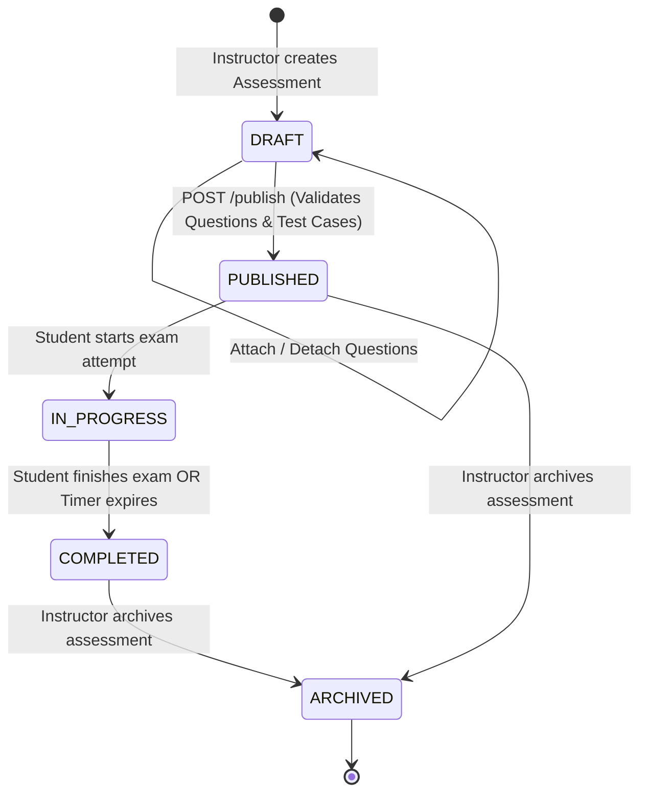

# Assessment Management & Orchestration Architecture

**Project:** Vedantu Online Coding Assessment Platform  
**Workspace:** `E:\VedantuCodingPlatform_New`  
**Milestone:** Stage 4 — Question Bank, Assessment Orchestration & Code Evaluation

---

## 1. Overview & System Lifecycle

The Assessment Orchestration module manages timed online coding examinations, candidate assignments, language restrictions, and evaluation states. It enforces strict server-authoritative timings, prevents exam re-taking, and provides comprehensive cohort analytics for instructors.

---

## 2. Assessment State Machine & Transition Rules

1. **`DRAFT` (Initial State):**
   - Authoring state. The instructor configures title, duration in minutes, total marks, passing marks, allowed languages, and attaches questions from the Question Bank.
   - Candidates cannot view or start draft assessments.
2. **`PUBLISHED`:**
   - Active state ready for examination.
   - **Publishing Preflight Guard:** Transitioning from `DRAFT` to `PUBLISHED` validates that:
     1. The assessment has at least one question attached (`len(questions) >= 1`).
     2. Every attached question has at least one test case configured (`len(q.test_cases) >= 1`).
   - If either condition fails, the API rejects the transition with HTTP 400 Bad Request.
3. **`IN_PROGRESS`:**
   - Active candidate examination session.
   - Initiated when an enrolled student starts their attempt (`POST /api/v1/student/assessments/{id}/start`).
4. **`COMPLETED`:**
   - Finalized state for an individual student attempt.
   - Transitions to completed upon manual candidate submission or upon server-side timer expiration.
   - Final grades are aggregated, percentage is computed, and pass/fail is determined against `passing_marks`.
5. **`ARCHIVED`:**
   - Preserves historical examination records, submission code, and scores for auditing while removing the assessment from active student listings.

---

## 3. Server-Authoritative Timer & Grace Period

To eliminate client-side time manipulation, all examination timing is governed strictly by the backend server:

$$\text{Elapsed Time} = \text{now}_{\text{UTC}} - \text{attempt.started\_at}$$

$$\text{Remaining Seconds} = (\text{assessment.duration\_minutes} \times 60) + 15 - \text{Elapsed Time}$$

### 3.1 Network Latency Grace Period (15 Seconds)
- A 15-second grace period is automatically appended server-side to account for network transmission latency during final submission packet transfers.
- In the frontend UI, when the primary countdown reaches `00:00`, the timer transitions to an amber/red pulsing banner indicating the active grace period (`Grace: 15s`).
- If a submission arrives after `duration_minutes * 60 + 15` seconds, the server immediately marks the attempt as `COMPLETED`, records `submitted_at`, and rejects the submission with HTTP 403 Forbidden.

---

## 4. Candidate Enrollment & Eligibility

Candidate access is controlled via the `assessment_candidates` junction table:
- **Assigned Assessments:** An instructor explicitly assigns eligible students via `POST /api/v1/assessments/{id}/candidates` by providing student user UUIDs.
- **Enforcement:** When a student queries `GET /api/v1/student/assessments`, only assessments where the student is enrolled in `assessment_candidates` or where the assessment is designated as open are returned.
- **One-Attempt Constraint:** A database-level `UniqueConstraint("assessment_id", "user_id")` on `assessment_attempts` strictly enforces a one-attempt-per-student policy. Attempts cannot be duplicated or re-opened once in `COMPLETED` status.

---

## 5. Candidate Code Draft Autosaving

To protect candidates against browser crashes, network dropouts, or accidental tab closures:
- Candidates' code is continuously autosaved to the `code_drafts` table via `POST /api/v1/student/assessments/{id}/drafts`.
- Each draft is uniquely constrained by `(user_id, assessment_id, question_id)`.
- When an active assessment is resumed or refreshed, `POST /api/v1/student/assessments/{id}/start` returns the student's saved drafts for every question, instantly restoring their workspace.

---

## 6. API Endpoints Reference

| Method | Endpoint | RBAC Role | Description |
|---|---|---|---|
| `POST` | `/api/v1/assessments` | `INSTRUCTOR`, `ADMIN` | Create new assessment in DRAFT status |
| `GET` | `/api/v1/assessments` | `INSTRUCTOR`, `ADMIN` | List assessments with status and pagination filters |
| `GET` | `/api/v1/assessments/{id}` | `INSTRUCTOR`, `ADMIN` | Get full assessment detail including question bank links |
| `PUT` | `/api/v1/assessments/{id}` | `INSTRUCTOR`, `ADMIN` | Update assessment metadata and question bindings |
| `POST` | `/api/v1/assessments/{id}/publish` | `INSTRUCTOR`, `ADMIN` | Validate questions/test cases and transition to PUBLISHED |
| `POST` | `/api/v1/assessments/{id}/candidates` | `INSTRUCTOR`, `ADMIN` | Enroll candidate student UUIDs |
| `GET` | `/api/v1/assessments/{id}/results` | `INSTRUCTOR`, `ADMIN` | View examination cohort results and student rankings |
| `DELETE` | `/api/v1/assessments/{id}` | `INSTRUCTOR`, `ADMIN` | Archive assessment |
| `GET` | `/api/v1/student/assessments` | `STUDENT` | List available published assessments for student |
| `GET` | `/api/v1/student/assessments/{id}/instructions` | `STUDENT` | Get pre-exam instructions and guidelines |
| `POST` | `/api/v1/student/assessments/{id}/start` | `STUDENT` | Start/resume examination attempt and initialize timer |
| `POST` | `/api/v1/student/assessments/{id}/drafts` | `STUDENT` | Autosave intermediate code draft for a question |
| `POST` | `/api/v1/student/assessments/{id}/finish` | `STUDENT` | Finalize examination attempt and calculate score |
| `GET` | `/api/v1/student/assessments/{id}/result` | `STUDENT` | Retrieve student's own final grade scorecard |

---

## 7. Verification & Automated Testing

Validated in `backend/tests/test_stage4.py`:
- `test_assessment_create_and_publish_validation`: Confirms empty assessments cannot be published, and valid assessments transition to `PUBLISHED`.
- `test_assessment_candidate_assignment`: Verifies candidate student enrollment.
- `test_student_start_assessment_and_draft_autosave`: Verifies attempt session initiation, server timer calculation, and draft persistence.
