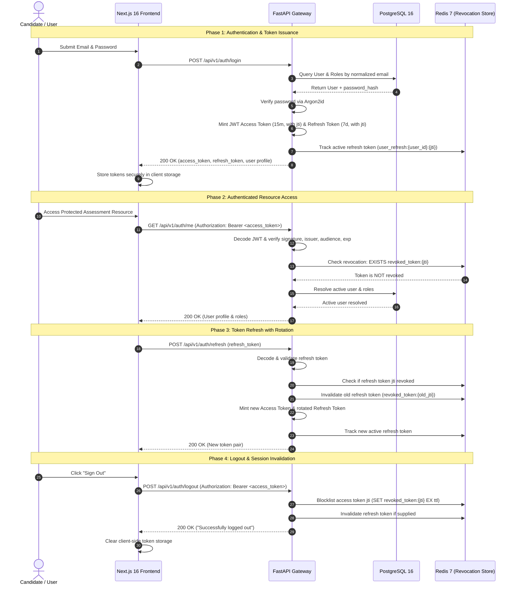

# Authentication, User Management & RBAC Architecture Guide

## 1. Executive Summary & Security Objectives

The **Vedantu Online Coding Assessment Platform** enforces an enterprise-grade, asynchronous authentication and Role-Based Access Control (RBAC) system in Stage 3. The architecture protects assessment integrity, candidate identity, and institutional administrative data using state-of-the-art cryptography, dual-token JWT lifecycles, and real-time Redis token revocation.

### Core Security Guarantees
- **Modern Password Hashing**: Passwords hashed using **Argon2id** with OWASP-recommended memory, iteration, and parallelism parameters. Zero plaintext passwords stored or exposed.
- **Dual-Token Architecture**: Short-lived (15-minute) signed JWT access tokens coupled with longer-lived (7-day) refresh tokens.
- **Server-Authoritative Refresh Token Rotation**: Refreshing an access token revokes the old refresh token and issues a newly rotated token pair.
- **Real-Time Revocation via Redis**: Immediate session revocation on `/auth/logout` by indexing unique token identifiers (`jti`) in `vedantu-redis` with remaining TTL expiration.
- **Privilege Escalation Prevention**: Public self-registration assigns the `STUDENT` role strictly. Any attempt to supply role parameters or claim `ADMIN`/`INSTRUCTOR` status is rejected with HTTP 422 Unprocessable Content.
- **Generic Credential Failure Messages**: Constant-time comparison and unified error messages ("Invalid email or password") prevent user enumeration.

---

## 2. Authentication Flow Architecture



---

## 3. Cryptographic and Password Hashing Foundation

Implemented in [`backend/app/core/security.py`](file:///E:/VedantuCodingPlatform_New/backend/app/core/security.py):

### 3.1 Argon2id Configuration
Password hashing utilizes `argon2-cffi` configured with industry-standard parameters:
- **Algorithm**: Argon2id (hybrid data-dependent / data-independent memory access resistant to GPU and side-channel cracking)
- **Time Cost (`time_cost`)**: `3` iterations
- **Memory Cost (`memory_cost`)**: `65,536 KiB` (64 MiB)
- **Parallelism (`parallelism`)**: `4` threads
- **Salt Length**: `16` bytes
- **Hash Length**: `32` bytes

### 3.2 Password Policy Enforcement
Passwords submitted during registration undergo strict regex validation before hashing:
- Minimum length: 8 characters (maximum 128 characters)
- At least one lowercase letter (`[a-z]`)
- At least one uppercase letter (`[A-Z]`)
- At least one decimal digit (`[0-9]`)
- At least one special symbol (`[!@#$%^&*()_+\-=\[\]{};':"\\|,.<>/?]`)

---

## 4. JWT Token Architecture & Redis Invalidation

### 4.1 Token Specifications
Both Access and Refresh tokens are signed with HMAC-SHA256 (`HS256`) using `JWT_SECRET_KEY` (minimum 32 characters read from `.env`):

| Claim | Access Token | Refresh Token | Description |
|---|---|---|---|
| `sub` | `<user_uuid>` | `<user_uuid>` | Primary identity subject |
| `type` | `"access"` | `"refresh"` | Distinguishes token functional role |
| `jti` | `<uuid.hex>` | `<uuid.hex>` | Globally unique token ID used for revocation |
| `iss` | `vedantu-assessment-platform` | `vedantu-assessment-platform` | Validated issuer claim |
| `aud` | `vedantu-assessment-users` | `vedantu-assessment-users` | Validated audience claim |
| `roles` | `["STUDENT"]` | *None* | Cached roles for fast authorization |
| `iat` | Unix timestamp | Unix timestamp | Issued-at time |
| `exp` | `iat + 15 minutes` | `iat + 7 days` | Hard expiration boundary |

### 4.2 Redis Blacklisting Mechanics ([`backend/app/core/redis.py`](file:///E:/VedantuCodingPlatform_New/backend/app/core/redis.py))
- **Revocation Store**: Active `vedantu-redis` instance (`127.0.0.1:6379`).
- **Key Schema**: `revoked_token:{jti}` with TTL set to the exact remaining validity period of the token (`exp - now`).
- **Storage Efficiency**: Once the token reaches its natural expiration, Redis automatically evicts the revocation tombstone, maintaining a strictly bounded memory footprint.
- **Refresh Token Rotation**: Old refresh tokens are blacklisted immediately upon renewal to neutralize replay attacks.

---

## 5. Role-Based Access Control (RBAC) Specification

The platform implements a strict multi-tier hierarchy supporting three canonical roles:

```text
                     +---------------+
                     |     ADMIN     |  (Full Governance & User Directory)
                     +---------------+
                             |
                             v  (Supervisory Access)
                     +---------------+
                     |  INSTRUCTOR   |  (Question Authoring & Assessment Grading)
                     +---------------+
                             |
                             v  (Assessment Participation)
                     +---------------+
                     |    STUDENT    |  (Candidate Exam Taking & Submission)
                     +---------------+
```

### 5.1 Reusable Dependencies ([`backend/app/api/deps.py`](file:///E:/VedantuCodingPlatform_New/backend/app/api/deps.py))
- `get_current_user`: Resolves authenticated `User` from JWT, validates active account status, eagerly loads assigned roles.
- `require_admin`: Enforces `ADMIN` role.
- `require_instructor`: Enforces `INSTRUCTOR` or `ADMIN` role.
- `require_student`: Enforces `STUDENT`, `INSTRUCTOR`, or `ADMIN` role.

---

## 6. API Endpoint Reference

All endpoints are registered under `/api/v1/auth`:

### Public Endpoints
- `POST /api/v1/auth/register`: Candidate self-registration. Validates password complexity, checks for duplicate email, assigns `STUDENT` role, returns initial token pair.
- `POST /api/v1/auth/login`: Authenticates credentials with generic error messages. Returns JWT access and refresh tokens.
- `POST /api/v1/auth/refresh`: Exchanges a valid refresh token for a rotated token pair.

### Authenticated Endpoints
- `POST /api/v1/auth/logout`: Revokes active access and refresh tokens in Redis.
- `GET /api/v1/auth/me`: Returns sanitized user profile (`id`, `full_name`, `email`, `status`, `roles`, `created_at`). Never leaks `password_hash`.

### RBAC Protected Endpoints
- `GET /api/v1/auth/admin/users`: Lists all registered users. Restricted strictly to `ADMIN` (HTTP 403 for Instructor or Student).
- `GET /api/v1/auth/instructor/dashboard`: Restricted to `INSTRUCTOR` or `ADMIN` (HTTP 403 for Student).
- `GET /api/v1/auth/student/profile`: Restricted to `STUDENT`, `INSTRUCTOR`, or `ADMIN`.

---

## 7. Frontend Foundation Integration

Implemented in the Next.js 16 application ([`frontend/`](file:///E:/VedantuCodingPlatform_New/frontend)):
- **TypeScript Contracts** ([`frontend/src/types/auth.ts`](file:///E:/VedantuCodingPlatform_New/frontend/src/types/auth.ts)): Typed interfaces for `UserProfile`, `TokenResponse`, `LoginPayload`, `RegisterPayload`.
- **Client Storage** ([`frontend/src/lib/auth/tokenStorage.ts`](file:///E:/VedantuCodingPlatform_New/frontend/src/lib/auth/tokenStorage.ts)): Safe client-side token access with SSR guards.
- **Auth Client** ([`frontend/src/lib/api/auth.ts`](file:///E:/VedantuCodingPlatform_New/frontend/src/lib/api/auth.ts)): Native fetch helpers with automatic Authorization header injection and refresh token rotation.
- **Reactive State Context** ([`frontend/src/context/AuthContext.tsx`](file:///E:/VedantuCodingPlatform_New/frontend/src/context/AuthContext.tsx)): Global React context exposing `user`, `isAuthenticated`, `login`, `register`, `logout`, and role helpers (`isAdmin`, `isInstructor`, `isStudent`).
- **Interactive UI Component** ([`frontend/src/components/auth/AuthSection.tsx`](file:///E:/VedantuCodingPlatform_New/frontend/src/components/auth/AuthSection.tsx)): Accessible tabbed interface for candidate registration, sign-in, active session inspection, and logout.

---

## 8. Automated Testing & Verification Suite

The backend test suite was expanded with 16 dedicated tests in [`backend/tests/test_auth.py`](file:///E:/VedantuCodingPlatform_New/backend/tests/test_auth.py), bringing the test suite to **40 passed tests** across all modules:

```powershell
$env:PYTHONPATH="E:\VedantuCodingPlatform_New\backend"
pytest backend/tests -v
# Result: 40 passed in 6.10s
```

### Coverage Breakdown
1. `test_student_registration_success`: Verified student account creation with `STUDENT` role.
2. `test_student_registration_rejects_duplicate_email`: Verified duplicate email returns 409 Conflict.
3. `test_student_registration_weak_password_rejected`: Verified rejection of passwords failing policy.
4. `test_registration_prevents_privilege_escalation`: Verified extra fields (`role='ADMIN'`) rejected with 422.
5. `test_login_valid_credentials`: Verified successful login and token payload generation.
6. `test_login_invalid_password_returns_generic_error`: Verified 401 with generic message on wrong password.
7. `test_login_unknown_email_returns_generic_error`: Verified 401 with generic message on unknown email.
8. `test_login_inactive_user_rejected`: Verified suspended accounts are rejected with 403.
9. `test_get_current_user_profile`: Verified `/auth/me` returns sanitized profile and roles.
10. `test_unauthenticated_request_rejected`: Verified missing credentials return 401.
11. `test_expired_jwt_rejected`: Verified expired tokens return 401.
12. `test_invalid_signature_jwt_rejected`: Verified signature tampering returns 401.
13. `test_token_refresh_and_rotation`: Verified refresh token rotation and rejection of old tokens.
14. `test_logout_invalidates_token_in_redis`: Verified Redis blacklisting immediately blocks revoked tokens.
15. `test_rbac_admin_endpoint_permissions`: Verified Admin access (200), Instructor access (403), Student access (403) on `/admin/users`.
16. `test_rbac_instructor_endpoint_permissions`: Verified Instructor access (200), Admin access (200), Student access (403) on `/instructor/dashboard`.
