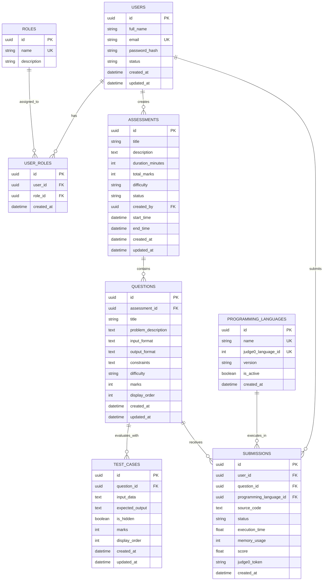

# Database Architecture & Domain Foundation Guide

## 1. Executive Summary & Technology Stack

The **Vedantu Online Coding Assessment Platform** employs an enterprise-grade, asynchronous relational database architecture powered by PostgreSQL 16, SQLAlchemy 2.0 ORM, and Alembic database migrations.

In Stage 2.6, the platform establishes the foundational database connectivity, connection pooling, transactional session management, and eight core domain models representing the educational assessment domain.

| Component | Technology | Version | Purpose |
|---|---|---|---|
| **Database Engine** | **PostgreSQL** | `16.15` (`postgres:16-alpine`) | ACID-compliant relational store with native UUID and JSONB capabilities. |
| **ORM Layer** | **SQLAlchemy** | `2.1.8` (`sqlalchemy[asyncio]`) | Modern 2.0 declarative models (`DeclarativeBase`, `Mapped`, `mapped_column`). |
| **Database Driver** | **psycopg** | `3.3.8` (`psycopg[binary]`) | High-performance asynchronous and synchronous PostgreSQL 3 driver. |
| **Migration Tool** | **Alembic** | `1.20.1` | Automated, auditable schema revisions with async environment runners. |
| **Async Runtime Engine** | **greenlet** | `3.5.6` | Cooperative concurrency primitives required for SQLAlchemy asyncio. |

---

## 2. Database Connection Architecture & Lifecycle

### 2.1 Configuration & URL Assembly
Database connection parameters are managed through Pydantic `Settings` (`backend/app/core/config.py`), reading securely from `.env` with strict zero-hardcoded-secret enforcement:

- `POSTGRES_SERVER`: Hostname or IP (`127.0.0.1` for local development).
- `POSTGRES_PORT`: Port (`5432`).
- `POSTGRES_USER`: Service user (`vedantu_admin`).
- `POSTGRES_PASSWORD`: Secret password (minimum 16 characters validated during preflight).
- `POSTGRES_DB`: Target database name (`vedantu_assessment_db`).

The application dynamically computes `async_database_url` and `sync_database_url` using the modern `postgresql+psycopg://` URI scheme:
```text
postgresql+psycopg://<user>:<password>@<server>:<port>/<database>
```

### 2.2 Connection Pooling & Pre-Ping
Connection pooling is established in `backend/app/core/database.py`:
- **`DB_POOL_SIZE`**: `10` persistent connections per process.
- **`DB_MAX_OVERFLOW`**: `20` additional burst connections during peak assessment submission traffic.
- **`DB_POOL_TIMEOUT`**: `30` seconds maximum wait time before connection pool exhaustion exception.
- **`DB_POOL_RECYCLE`**: `1800` seconds (30 minutes) automatic recycling to prevent stale socket accumulation.
- **`pool_pre_ping=True`**: Active health probes (`SELECT 1`) on connection checkout to recover from container restarts.

### 2.3 Windows Event Loop Policy Compatibility
On Windows systems, psycopg 3 async connections require the `WindowsSelectorEventLoopPolicy` rather than the default `ProactorEventLoop`. Both `backend/app/core/database.py` and `backend/alembic/env.py` automatically configure:
```python
if sys.platform == "win32":
    asyncio.set_event_loop_policy(asyncio.WindowsSelectorEventLoopPolicy())
```

### 2.4 FastAPI Session Dependency (`get_db`)
The application defines a transactional async generator dependency `get_db` yielding an `AsyncSession`:
- Commits transactions automatically upon clean request completion.
- Rolls back transactions automatically on unhandled exceptions.
- Guarantees session closure in a `finally` block to prevent connection leaks.

---

## 3. Entity-Relationship Domain Models



### 3.1 Entity Details

1. **`User` (`backend/app/models/user.py`)**:
   - Primary key: UUID (`uuid.uuid4()`).
   - Fields: `full_name`, `email` (unique index), `password_hash`, `status` (`ACTIVE`, `INACTIVE`, `SUSPENDED`).
   - Inherits `TimestampMixin` (`created_at`, `updated_at` in timezone-aware UTC).

2. **`Role` & `UserRole` (`backend/app/models/role.py`)**:
   - `Role`: Unique `name` (`ADMIN`, `INSTRUCTOR`, `STUDENT`), optional `description`.
   - `UserRole`: Join entity with composite unique constraint `uq_user_roles_user_role` on `(user_id, role_id)`.
   - Cascade: `ON DELETE CASCADE` on both user and role foreign keys.

3. **`Assessment` (`backend/app/models/assessment.py`)**:
   - Fields: `title`, `description`, `duration_minutes`, `total_marks`, `difficulty` (`EASY`, `MEDIUM`, `HARD`), `status` (`DRAFT`, `PUBLISHED`, `ARCHIVED`), `created_by` (FK to `users.id`).
   - Cascade: `ON DELETE RESTRICT` on `created_by` ensuring instructors cannot be deleted while authoring assessments.

4. **`Question` (`backend/app/models/question.py`)**:
   - Fields: `assessment_id` (FK to `assessments.id`), `title`, `problem_description`, `input_format`, `output_format`, `constraints`, `difficulty`, `marks`, `display_order`.
   - Cascade: `ON DELETE CASCADE` from parent `Assessment`.

5. **`TestCase` (`backend/app/models/test_case.py`)**:
   - Fields: `question_id` (FK to `questions.id`), `input_data`, `expected_output`, `is_hidden` (boolean, defaults to `True`), `marks`, `display_order`.
   - Security: Hidden test cases (`is_hidden=True`) are preserved exclusively for server-authoritative submission scoring and are never exposed via student question detail endpoints.
   - Cascade: `ON DELETE CASCADE` from parent `Question`.

6. **`ProgrammingLanguage` (`backend/app/models/programming_language.py`)**:
   - Fields: `name` (unique), `judge0_language_id` (unique integer ID), `version`, `is_active` (boolean, defaults to `True`), `created_at`.
   - Aligned directly with Judge0 Community Edition runtime IDs (Python 3: `71`, Java: `62`).

7. **`Submission` (`backend/app/models/submission.py`)**:
   - Fields: `user_id` (FK to `users.id`), `question_id` (FK to `questions.id`), `programming_language_id` (FK to `programming_languages.id`), `source_code`, `status` (`PENDING`, `ACCEPTED`, `WRONG_ANSWER`, `TIME_LIMIT_EXCEEDED`, `COMPILATION_ERROR`, `RUNTIME_ERROR`), `execution_time`, `memory_usage`, `score`, `judge0_token`, `created_at`.
   - Referential Integrity: `ON DELETE RESTRICT` on student `user_id`, `question_id`, and `programming_language_id` guarantees permanent auditability of submitted code.

---

## 4. Alembic Migration Architecture

### 4.1 Migration Layout
```text
backend/
|-- alembic.ini                  # Migration configuration with dynamic settings override
|-- alembic/
|   |-- env.py                   # Async Alembic execution environment
|   |-- script.py.mako           # Migration script generation template
|   |-- versions/
|       |-- 2026_11_07_1413-3faee3e02f86_initial_database_schema.py
```

### 4.2 Migration Operations

- **Apply Migrations**:
  ```bash
  $env:PYTHONPATH="E:\VedantuCodingPlatform_New\backend"
  .\backend\.venv\Scripts\alembic.exe -c backend/alembic.ini upgrade head
  ```

- **Verify Current Revision**:
  ```bash
  $env:PYTHONPATH="E:\VedantuCodingPlatform_New\backend"
  .\backend\.venv\Scripts\alembic.exe -c backend/alembic.ini current
  # Output: 3faee3e02f86 (head)
  ```

- **Isolated Downgrade Verification**:
  Downgrade mechanics were verified using `scripts/verify_migration_downgrade.py` in an ephemeral schema (`test_disposable_schema`). The script executes `upgrade head` followed by `downgrade base`, confirming all domain tables drop cleanly without affecting the application's active public schema.

---

## 5. Database Seeding Pipeline

Initial platform data is provisioned via `scripts/seed_database.py`:
- **Roles**:
  - `ADMIN`: Platform-wide governance and user management.
  - `INSTRUCTOR`: Assessment creation, question authoring, and evaluation.
  - `STUDENT`: Candidate participating in timed coding assessments.
- **Programming Languages**:
  - `Python 3`: Judge0 ID `71`, version `3.8.1`, active.
  - `Java`: Judge0 ID `62`, version `13.0.1`, active.

The seeding script is completely **idempotent** and can be run repeatedly without duplicating records or throwing constraint errors:
```bash
$env:PYTHONPATH="E:\VedantuCodingPlatform_New\backend"
.\backend\.venv\Scripts\python.exe scripts/seed_database.py
```

---

## 6. Automated Testing & Verification Suite

The database layer is validated by 8 dedicated asynchronous tests in `backend/tests/test_database.py`:

1. `test_database_connectivity_live`: Validates live async connection and ping against PostgreSQL 16.
2. `test_fastapi_get_db_dependency`: Validates generator yield, transaction commit, and session closure.
3. `test_user_creation_and_uuid_generation`: Validates UUID generation and UTC timestamps.
4. `test_user_email_uniqueness_constraint`: Validates rejection of duplicate emails via `IntegrityError`.
5. `test_role_and_user_role_assignment`: Validates role creation and compound `(user_id, role_id)` uniqueness.
6. `test_seeded_programming_languages_exist`: Validates presence of Python 3 (`71`) and Java (`62`).
7. `test_assessment_question_testcase_hierarchy_and_cascade`: Validates parent-child cascade deletions.
8. `test_submission_and_restrict_cascades`: Validates submission creation and `ON DELETE RESTRICT` protection.

Full test suite execution:
```bash
$env:PYTHONPATH="E:\VedantuCodingPlatform_New\backend"
.\backend\.venv\Scripts\pytest.exe backend/tests -v
# Result: 24 passed in 1.44s
```
