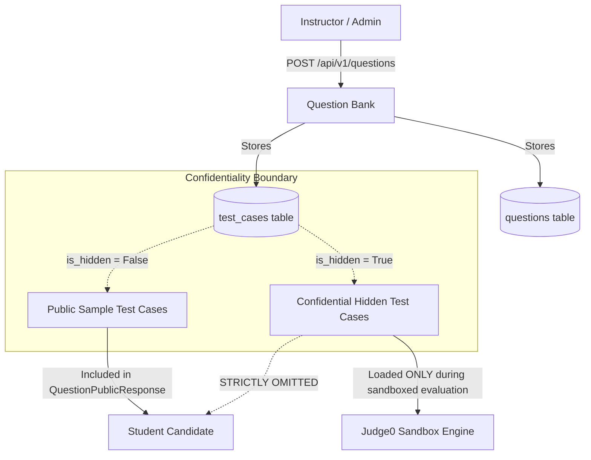

# Question Bank & Test Case Isolation Architecture

**Project:** Vedantu Online Coding Assessment Platform  
**Workspace:** `E:\VedantuCodingPlatform_New`  
**Milestone:** Stage 4 — Question Bank, Assessment Orchestration & Code Evaluation

---

## 1. Overview & Architectural Objectives

The Question Bank serves as the centralized repository for algorithmic, data-structure, and system-level coding problems within the Vedantu Online Coding Assessment Platform. It enables instructors and administrators to author, categorize, version, and attach programming challenges to timed examinations.

A core pillar of the Question Bank design is **zero-leakage test case confidentiality**. While candidate students must receive clear problem descriptions and illustrative sample test cases to understand expected formats, private validation test cases (including edge cases, performance stress tests, and large scale inputs) must remain strictly confidential on the backend.



---

## 2. Domain Data Model & Schema

Questions and Test Cases are modeled using SQLAlchemy 2.0 async declarative entities in `app.models.question` and `app.models.test_case`:

### 2.1 `questions` Entity
- `id`: UUID (Primary Key)
- `assessment_id`: UUID (Foreign Key `assessments.id`, nullable, ondelete="CASCADE")
- `title`: String(255) — Challenge title
- `problem_description`: Text — Comprehensive markdown statement
- `input_format`: Text — Standard input specification
- `output_format`: Text — Standard output format specification
- `constraints`: Text — Constraints on input values, time, and space
- `difficulty`: String(50) — `EASY`, `MEDIUM`, or `HARD`
- `topic`: String(100) — E.g., `Arrays`, `Dynamic Programming`, `Graphs`, `Math`
- `marks`: Integer — Maximum marks allocated to this question (default: 10)
- `time_limit_seconds`: Float — Per-testcase CPU timeout (default: 2.0s, bounded 0.1s to 15.0s)
- `memory_limit_mb`: Integer — Per-testcase memory cap (default: 256MB)
- `display_order`: Integer — Order of appearance in assessments
- `is_archived`: Boolean — Soft-deletion flag to protect historical submissions
- `created_by`: UUID (Foreign Key `users.id`, ondelete="SET NULL")

### 2.2 `test_cases` Entity
- `id`: UUID (Primary Key)
- `question_id`: UUID (Foreign Key `questions.id`, ondelete="CASCADE")
- `input_data`: Text — Stdin input fed to student program
- `expected_output`: Text — Expected stdout to match
- `explanation`: Text (Optional) — Educational explanation for public sample cases
- `is_hidden`: Boolean — `False` for public sample cases, `True` for evaluation tests
- `marks`: Integer — Weight of this individual test case
- `display_order`: Integer — Order of test case execution

---

## 3. Strict Test Case Isolation Mechanism

### 3.1 Separation of Public vs. Administrative Schemas
To guarantee that confidential test cases are never transmitted over the network to student browsers, two distinct Pydantic response models are maintained:

1. **`QuestionAdminResponse` (Instructors & Admins):**
   Includes the full `test_cases: List[TestCaseAdminResponse]` array, revealing both sample and hidden test case inputs, expected outputs, and individual weights.
2. **`QuestionPublicResponse` (Students):**
   Exposes ONLY `sample_test_cases: List[TestCasePublicResponse]`. Filtered strictly at the ORM serialization layer:
   ```python
   sample_cases = [
       TestCasePublicResponse(
           id=tc.id,
           input_data=tc.input_data,
           expected_output=tc.expected_output,
           explanation=tc.explanation,
           marks=tc.marks,
           display_order=tc.display_order,
       )
       for tc in q.test_cases
       if not tc.is_hidden
   ]
   ```

### 3.2 Evaluation Projection Security
Even during live submission evaluation, the results returned to the student (`TestCaseResultPublic`) omit confidential inputs and expected outputs:
- For `is_sample == True`: `sample_input` and `sample_expected` are returned so the student can debug why their code failed.
- For `is_sample == False`: `sample_input` and `sample_expected` are set to `None`. The student is informed of the outcome (`ACCEPTED`, `WRONG_ANSWER`, `TIME_LIMIT_EXCEEDED`, etc.) and marks awarded, preventing test case reverse engineering.

---

## 4. API Endpoints Reference

| Method | Endpoint | RBAC Role | Description |
|---|---|---|---|
| `POST` | `/api/v1/questions` | `INSTRUCTOR`, `ADMIN` | Create a new question with sample and hidden test cases |
| `GET` | `/api/v1/questions` | `INSTRUCTOR`, `ADMIN` | List questions with filters (`topic`, `difficulty`, `is_archived`) |
| `GET` | `/api/v1/questions/{id}` | Authenticated | Retrieve question. Instructors get full test suite; Students get public samples only |
| `PUT` | `/api/v1/questions/{id}` | `INSTRUCTOR`, `ADMIN` | Update question parameters and metadata |
| `DELETE` | `/api/v1/questions/{id}` | `INSTRUCTOR`, `ADMIN` | Soft-delete / archive question |
| `POST` | `/api/v1/questions/{id}/test-cases` | `INSTRUCTOR`, `ADMIN` | Append a new test case to an existing question |
| `DELETE` | `/api/v1/questions/{id}/test-cases/{tc_id}` | `INSTRUCTOR`, `ADMIN` | Remove a test case |

---

## 5. Automated Verification & Testing

The Question Bank implementation is validated by automated integration tests in `backend/tests/test_stage4.py`:
- `test_create_question_with_sample_and_hidden_test_cases`: Confirms question creation and testcase persistence.
- `test_question_test_case_confidentiality_isolation`: Validates that hidden test cases are never leaked in student payloads.
- `test_question_archive_soft_delete`: Confirms soft-delete filters archived questions from active candidate pools while preserving historical database references.
