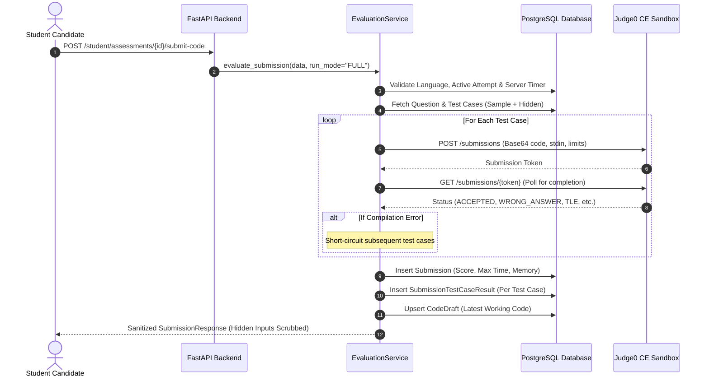

# Submission & Code Evaluation Architecture

**Project:** Vedantu Online Coding Assessment Platform  
**Workspace:** `E:\VedantuCodingPlatform_New`  
**Milestone:** Stage 4 — Question Bank, Assessment Orchestration & Code Evaluation

---

## 1. Overview & Execution Architecture

The Code Evaluation module interfaces the FastAPI backend with self-hosted Judge0 Community Edition v1.13.1 containers running in isolated Docker networks. It provides dual execution modes:
1. **Interactive Sample Testing (`run_sample`):** Quick execution against public sample test cases without recording permanent submissions.
2. **Formal Examination Evaluation (`submit_code`):** Comprehensive evaluation against all sample and confidential hidden test cases, calculating marks, recording audit trails in `submissions` and `submission_test_case_results`, and updating student draft code.

---

## 2. Judge0 Status Mapping & Resiliency Matrix

Judge0 execution status IDs are strictly normalized to platform evaluation states:

| Judge0 Status ID | Judge0 Description | Platform Status | Score Impact |
|---|---|---|---|
| **3** | `Accepted` | `ACCEPTED` | Awards testcase marks |
| **4** | `Wrong Answer` | `WRONG_ANSWER` | 0 marks |
| **5** | `Time Limit Exceeded` | `TIME_LIMIT_EXCEEDED` | 0 marks |
| **6** | `Compilation Error` | `COMPILATION_ERROR` | 0 marks, short-circuits remaining test cases |
| **7..12** | `Runtime Error (SIGSEGV, NZEC, etc.)` | `RUNTIME_ERROR` | 0 marks |
| **13..14** | `Internal Error / Exec Format Error` | `INTERNAL_ERROR` | 0 marks (not penalized) |
| **Network Timeout** | Connection / Polling Timeout | `INTERNAL_ERROR` | 0 marks (not penalized) |

### 2.1 Compilation Error Short-Circuiting
If code fails to compile (Judge0 status 6) on the first testcase, compiling failed for all test cases. The evaluation service immediately flags subsequent test cases as `COMPILATION_ERROR` with 0 marks and skips further sandbox invocations, drastically reducing queue load.

### 2.2 Infrastructure Failure Resilience
If the Judge0 sandbox times out or encounters a network disruption, the test case is recorded as `INTERNAL_ERROR`. The error message states: `"Sandbox execution unavailable or timed out. Candidate not penalized."`

---

## 3. Supported Programming Language Runtimes

| Language | Judge0 Language ID | Version | Command / Runtime | Memory Limit Override |
|---|---|---|---|---|
| **Python 3** | `71` | `3.8.1` | Python 3.8.1 | Default ($256 \text{ MB}$) |
| **Java** | `62` | `13.0.1` | OpenJDK 13.0.1 | Set to $\max(\text{limit}, 3{,}000{,}000 \text{ KB})$ for JVM virtual address space |

### 3.1 Java 64-bit JVM Memory Handling
Java 13 requires a minimum 3 GB virtual address space (`RLIMIT_AS`) during JVM thread initialization. The Judge0 service automatically elevates `memory_limit` to $3{,}000{,}000 \text{ KB}$ for Java requests while bounding process execution time to prevent runaway tasks.

---

## 4. Verification & Automated Testing

Validated in `backend/tests/test_stage4.py`:
- `test_judge0_python_evaluation_accepted_and_scoring`: Tests live Python execution against sample and hidden test cases, validating 100% score calculation.
- `test_judge0_compilation_error_short_circuits`: Tests broken Java compilation and confirms short-circuiting.
- `test_judge0_runtime_error_handled_gracefully`: Tests unhandled Python exceptions (e.g., division by zero) without backend crashes.
